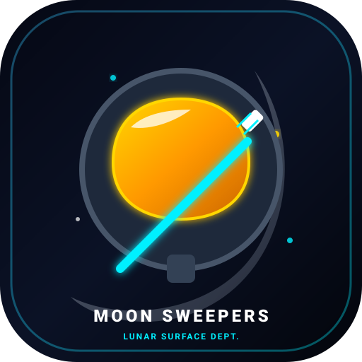

# 🌕 11Hopem Moon Sweepers (`moon-sweepers`)

<div align="center">
  
  <p><strong>Ay Yüzeyi Temizlik, Simülasyon ve Otomasyon Tycoon Oyunu</strong></p>

  [](https://github.com/umutocguder/moon-sweepers)
  [](https://github.com/umutocguder/moon-sweepers)
  [](https://11hopem.com)
  [](https://moon-sweepers.vercel.app)
</div>

---

## 📌 1. Proje Vizyonu ve Oyun Hikayesi
**Moon Sweepers**, Lunar Surface Department (LSD) tarafından Ay'ı temizlemek üzere görevlendirilen bir astronotun macerasını konu alan interaktif bir simülasyon ve artımlı (incremental/tycoon) web oyunudur.

Başlangıç bütçeniz yalnızca **tek bir standart diş fırçası** almaya yetmiştir! Ay yüzeyindeki regolit tozlarını süpürün, depoya satıp **Lunar Kredisi (LC)** kazanın; el süpürgesi, siklon vakum makinesi, elektromanyetik süpürgeler, konveyör bantları ve otonom temizlik dronları ile küçük bir temizlik görevini devasa bir ay madenciliği ve otomasyon imparatorluğuna dönüştürün.

---

## 🌐 2. Canlı Bağlantılar ve Proje Künyesi
- **Canlı Oyun Platformu:** [https://moon-sweepers.vercel.app](https://moon-sweepers.vercel.app)
- **Özel GitHub Deposu:** [https://github.com/umutocguder/moon-sweepers](https://github.com/umutocguder/moon-sweepers)
- **Marka & Telif Sahibi:** [11Hopem](https://11hopem.com)
- **Geliştirici İletişim:** `umutocgdr@gmail.com`
- **Antigravity Proje Kimliği:** `f0ecd30b-5512-4d20-a6b9-125b0d2c30eb`

---

## 🎮 3. Oynanış Dinamikleri ve Mekanikler

### 1. Düşük Yerçekimi Süzülme Fiziği
Astronot `WASD` veya yön tuşlarıyla yönlendirilir. Ay yüzeyindeki düşük sürtünme katsayısı (`friction: 0.88`) ve pürüzsüz ivmelenme ile otantik bir uzay süzülme hissi sunar.

### 2. Ekipman Kademeleri (Tool Tiers)
1. 🪥 **Standart Diş Fırçası (Başlangıç):** Yarıçap 36px, vuruş başı 1 kg toz, 20 kg çanta kapasitesi.
2. 🧹 **Ay El Süpürgesi (200 LC):** Yarıçap 58px, vuruş başı 3 kg toz, 60 kg çanta.
3. 🌀 **Siklon Vakum Mk-I (850 LC):** Yarıçap 85px, sürekli çekim akışı, 160 kg çanta.
4. ⚡ **Elektromanyetik Süpürge (3.200 LC):** Yarıçap 130px, manyetik toz çekim aurası, 450 kg çanta.
5. 🚜 **Ay Süpürme Aracı Buggy (12.000 LC):** Yarıçap 210px, yüksek hız, çift ön silindir, 1.500 kg çanta.

### 3. Otomasyon İstasyonları (Pasif Gelir)
- 🛤️ **Konveyör Bantları (500 LC):** Tozları depoya otomatik aktarır.
- 🤖 **Otonom Temizlik Dronları (1.500 LC):** Harita üzerinde uçarak tozu otonom süpürür.
- 🔬 **Toz Saflaştırma İstasyonu (3.000 LC):** Satış değerini kalıcı olarak +%50 artırır.
- ☀️ **Güneş Enerjisi Dizisi (7.500 LC):** Otomasyon hızını 2 katına çıkarır.

### 4. Gizli Değerli Madenler
Tozların altında rastgele gizlenmiş **Helyum-3 Kristali (75 LC)**, **Titanyum Külçesi (160 LC)** ve **Kadim Uzaylı Vidası (600 LC)** gibi nadir cevherler bulunur.

---

## 🔊 4. Prosedürel Ses Sentezleyici (Web Audio API)
Hiçbir harici MP3 veya telifli ses dosyası kullanılmamıştır. Tüm ses efektleri saf Web Audio API osilatörleri ile prosedürel olarak üretilir:
- **Süpürme:** Beyaz gürültü ve üçgen dalga kazıma sesi.
- **Vakum:** Rezonanslı sinüs vakum çekim patlaması.
- **Depo Satışı:** Pentatonik dijital jeton ve yazar kasa arpejı.
- **Yükseltme:** Yükselen synth akoru.

---

## 🏗️ 5. Mimari, Teknoloji Yığını & Dizin Ağacı
```
moon-sweepers/
├── assets/                          # Vektörel ve Raster Marka Varlıkları
│   ├── logo.svg                     # Astronot & Diş Fırçası Logosu
│   ├── favicon.svg
│   ├── favicon.ico
│   ├── apple-touch-icon.png
│   └── og-image.png
├── public/                          # Prodüksiyon Dağıtım Paketi
│   ├── index.html                   # HTML5 Canvas 60 FPS Oyun
│   ├── assets/
│   ├── src/                         # ES Oyun Modülleri
│   ├── robots.txt
│   └── sitemap.xml
├── src/
│   ├── game/
│   │   ├── toolSystem.js            # Süpürge ve Vakum Kademeleri
│   │   ├── economySystem.js         # Krediler, Madenler ve Otomasyon
│   │   ├── lunarWorld.js            # Kraterler, Regolit Tozları & Depo
│   │   ├── player.js                # Astronot Fiziği ve Çanta
│   │   └── audioSynth.js            # Saf Web Audio API Sentezleyici
│   ├── services/
│   │   └── saveService.js           # SHA-256 Kriptografik Yedekleme
│   └── telemetry/
│       └── telemetryService.js      # PII Temizlemeli Firebase REST
├── tests/
│   └── game.test.js                 # %100 Başarılı Birim Testleri
├── .github/workflows/
│   └── ci-cd.yml                    # Otonom CI/CD Hattı
├── AGENTS.md                        # AI Ajan Standartları
├── CLAUDE.md                        # Claude Senkronizasyonu
├── WORKLOG.md                       # AI Handoff Ready Günlüğü
├── package.json
└── vercel.json                      # Vercel Konfigürasyonu
```

---

## 🛡️ 6. Sıfır Telif Riski & Veri Güvenliği
- **Kural 26 (Telif Kalkanı):** Kod tabanında üçüncü şahıslara ait hiçbir görsel, sprite veya ses dosyası kullanılmamıştır; tüm çizimler Canvas vektörleri ve Web Audio dalga boyları ile sıfırdan üretilmiştir.
- **Otomatik Kayıt:** İlerleme her 6 saniyede bir `localStorage` üzerine kaydedilir ve SHA-256 özetiyle doğrulanır.

---

## 🧪 7. Kurulum, Test ve Dağıtım Komutları
```bash
# Testleri Koşturma (%100 Başarı)
npm test

# Prodüksiyon Paketini Derleme
npm run build

# Yerel Sunucuyu Başlatma
npm start

# Vercel'e Canlı Dağıtım
npx -y vercel --prod --yes
```

---

## 🖋️ 8. 11Hopem İmzası ve Telif Hakları
Bu oyun **[11Hopem](https://11hopem.com)** tarafından geliştirilmiştir.

> **Telif Hakkı © 2026 11Hopem. Tüm hakları saklıdır.**  
> Resmi Web Sitesi: [https://11hopem.com](https://11hopem.com)
